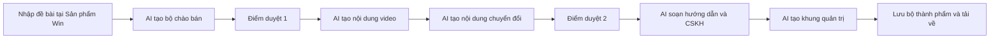

# 10X Mission Control — Một đề bài, năm hệ thống, hai điểm duyệt

Ngày: 28/10/2026. Trạng thái: đề xuất để người dùng xem và duyệt trước khi lập kế hoạch thực thi.

## 1. Mục tiêu và yêu cầu đã được người dùng xác nhận

Người dùng nhập một đề bài tại **Sản phẩm Win**, gồm ngách, bán cho ai, sản phẩm và giá bán. AI dùng chung đề bài và kết quả đã tạo để tự chuyển qua năm hệ thống: Sản phẩm Win → Kênh Video AI → Chuyển đổi → Giao hàng & CSKH → Quản trị. Không phải nhập lại thông tin ở từng tab.

Có đúng hai điểm duyệt nghiệp vụ:

1. Sau Sản phẩm Win: duyệt khách hàng mục tiêu, bộ chào bán, bảng gói/giá và định hướng nội dung.
2. Sau khi hoàn thành Kênh Video AI và Chuyển đổi: duyệt bộ nội dung quảng bá trước khi sử dụng.

Các bước nhỏ tự chạy. Duyệt xong thì tiếp tục tự động. Khi lỗi kỹ thuật hoặc thiếu dữ liệu quan trọng, phần mềm có thể dừng để xử lý; đó không phải điểm duyệt nghiệp vụ thứ ba.

Tiếp tục dùng Next.js, Tailwind CSS, thành phần shadcn/Radix và Lucide hiện có, OpenRouter phía máy chủ. Người dùng sẽ bổ sung thông tin Firebase và OpenRouter sau; không yêu cầu gửi khóa bí mật trong chat.

## 2. Đề bài mẫu đã xác nhận

| Trường | Giá trị người dùng cung cấp |
| --- | --- |
| Ngách | Chữ ký số dịch vụ công Kho bạc Nhà nước |
| Khách hàng | Kế toán ở Đà Nẵng |
| Sản phẩm | Chữ ký số |
| Nhà cung cấp | ICA |
| Hình thức | Cấp mới |
| VAT | Đã bao gồm |
| Thiết bị | Đã bao gồm USB Token |

| Gói | Giá nguyên VND | Thời hạn chính | Tặng thêm |
| --- | ---: | ---: | ---: |
| 1 năm | 1.792.800 | 12 tháng | 0 tháng |
| 2 năm | 2.690.000 | 24 tháng | 0 tháng |
| 3 năm | 3.080.000 | 36 tháng | 6 tháng |

Dữ liệu này được dùng làm preset có thể sửa, không hardcode duy nhất ngành chữ ký số vào toàn bộ ứng dụng. Giá lưu bằng số nguyên VND; thời hạn chính và thời gian tặng lưu riêng. Không tự thêm ưu đãi khác, đổi giá, coi đây là giá gia hạn hoặc tự xác định ngày hết hạn khi chưa có ngày kích hoạt.

Tên ICA, bảng giá và điều kiện trên là dữ liệu người dùng xác nhận. Chưa có tài liệu nhà cung cấp để kiểm chứng tính năng, thời gian xử lý hay tương thích kỹ thuật. Định hướng về dịch vụ công Kho bạc không tự trở thành cam kết tương thích đã được xác minh.

## 3. Đầu vào và cách nhập

Bốn trường chính hỗ trợ nhập nội dung riêng. Giá bán hỗ trợ nhiều gói, không còn giới hạn ở ba khoảng giá định sẵn. Phần bổ sung có nhà cung cấp, cấp mới/gia hạn, VAT, thiết bị, ưu đãi, thương hiệu, thông tin liên hệ và ghi chú/tài liệu nguồn.

Những trường bổ sung có thể để trống khi tạo bản nháp. Chỗ thiếu được đánh dấu rõ trong kết quả. Không tự điền số điện thoại, địa chỉ, tính năng hoặc cam kết dịch vụ. Không yêu cầu người dùng làm thêm một cuộc khảo sát trước khi bắt đầu.

## 4. Luồng hoạt động đề xuất

Chọn một hệ thống trong thanh điều hướng để xem không làm thay đổi trạng thái thực thi. Khi đến hệ thống mới, giao diện tự chuyển tab theo tiến trình; có nút quay lại bước đang chạy nếu người dùng đang xem kết quả cũ. Không điều hướng ra khỏi trình chỉnh sửa khi có nội dung chưa lưu.

Mỗi lần chạy là một **dự án** riêng. Đề bài, phiên bản nội dung, lựa chọn duyệt và các bước đã hoàn thành được lưu. Người dùng mở lại dự án để tiếp tục; không mất kết quả do đổi tab hoặc tải lại trang.

## 5. Đầu ra của từng hệ thống

Các số lượng dưới đây là giới hạn đề xuất của người thiết kế cho phiên bản đầu, chưa phải số lượng người dùng đã yêu cầu. Có thể điều chỉnh khi duyệt tài liệu.

| Hệ thống | Đầu ra đầu tiên đề xuất | Điều kiện chuyển tiếp |
| --- | --- | --- |
| Sản phẩm Win | Một bản định vị khách hàng, mô tả dịch vụ, bảng gói/giá, bộ chào bán và các thông tin còn thiếu | Điểm duyệt 1: người dùng sửa hoặc chấp thuận phiên bản nền |
| Kênh Video AI | Bốn kịch bản/caption theo Facebook, TikTok, Zalo và YouTube Shorts; mỗi kịch bản có hook, cảnh và CTA | Tự chuyển sang Chuyển đổi khi tạo và kiểm tra xong |
| Chuyển đổi | Bốn bài viết theo kênh, một trang giới thiệu dưới dạng nội dung, ba email theo dõi | Điểm duyệt 2: duyệt chung bộ quảng bá của hai hệ thống |
| Giao hàng & CSKH | Checklist cấp mới đề xuất, mẫu tin nhắn xác nhận, mười câu hỏi thường gặp và quy tắc chuyển người phụ trách | Tự chuyển sau khi hoàn thành và gắn nhãn phần chưa xác nhận |
| Quản trị | Mẫu theo dõi khách quan tâm/đơn hàng, hướng dẫn nhập số liệu và quy tắc tính tổng theo các gói | Hoàn thành bộ tài liệu; không tự sinh doanh thu thực tế |

Trong phiên bản tự chạy đầu tiên, video là **kịch bản**, trang giới thiệu là **nội dung trang**, hướng dẫn/CSKH là **tài liệu mẫu**. Không gọi chúng là MP4, website đã xuất bản, tin nhắn đã gửi hoặc nghiệp vụ đã thực hiện. Tạo ảnh, giọng đọc và dựng MP4 là bước mở rộng riêng sau khi chuỗi nội dung hoạt động ổn định.

Sản phẩm dịch vụ như ICA được đóng gói thành bộ chào bán phù hợp; không mặc định ép mọi đề bài thành ebook. Các loại sản phẩm khác được hỗ trợ bằng template tương ứng trong cùng cơ chế dữ liệu.

## 6. Hai điểm duyệt và phiên bản

- **Điểm 1** duyệt một snapshot của đề bài và bộ chào bán: thông tin sản phẩm, các gói giá, đối tượng, thông điệp. Có trường sửa và nút duyệt/tiếp tục. Nếu chưa có lợi thế hoặc thông số xác minh thì ghi rõ chưa có, không ép nhập dữ kiện bịa để được duyệt.
- **Điểm 2** hiển thị đồng thời thành phẩm của Video AI và Chuyển đổi. Người dùng có thể sửa từng mục rồi duyệt bộ phiên bản hiện tại. Các chỗ thiếu giá, thông tin liên hệ, điều kiện ưu đãi hoặc khẳng định quan trọng phải được bổ sung hoặc loại bỏ trước khi đánh dấu sẵn sàng sử dụng.
- Chỉnh sửa sau duyệt tạo phiên bản mới. Thay đổi dữ kiện nền như giá/nhà cung cấp làm mất duyệt các đầu ra phụ thuộc; thay đổi một bài viết chỉ làm mất duyệt mục đó và bộ duyệt 2. Không xóa phiên bản đã có.
- Khi sửa dữ liệu nền, dừng bước tiếp theo ở ranh giới công việc và thông báo những phần cần chạy lại. Không âm thầm tính phí để tái tạo toàn bộ chuỗi.
- Không tự gửi email, đăng mạng xã hội, kích hoạt chữ ký số, xử lý thanh toán hoặc gửi yêu cầu tới Kho bạc/ICA ở phiên bản này.

## 7. Thay đổi giao diện ở mức chức năng

Giữ giao diện vũ trụ và bản sửa hành tinh di chuyển chậm, tạm dừng khi tương tác, nút mở nhanh cố định.

Thêm đề bài chung tại Sản phẩm Win, bảng gói giá, danh sách dự án, tiến trình toàn chuỗi và hai màn hình duyệt. Các tab đọc cùng một dự án; có nhãn phân biệt đang chạy, chờ duyệt, hoàn thành và lỗi. Kho thành phẩm đọc nội dung đã lưu, mở lại không xóa văn bản AI.

Ẩn hoặc ghi rõ nhãn mô phỏng cho số giờ công, điểm đánh giá, số câu hỏi khảo sát và các chỉ số chưa đo. Không dùng bộ đếm thời gian hoặc nút tăng tốc làm bằng chứng AI đã hoàn thành một trạm. Trạng thái mô phỏng hiện có được tách riêng khỏi chạy AI thật.

Bản phác giao diện có thể dựng sau khi phạm vi này được thống nhất; không cần đổi nhận diện hoặc thiết kế lại toàn bộ ứng dụng.

## 8. Dữ liệu và thực thi

### Mô hình dữ liệu đề xuất

- `Project`: id, tên, đề bài hiện hành, phiên bản nền, trạng thái chung, thời điểm tạo/sửa.
- `Brief`: ngách, khách hàng/khu vực, sản phẩm, nhà cung cấp, cấp mới/gia hạn, danh sách gói giá, VAT/Token, liên hệ, nguồn/ghi chú.
- `SystemRun`: projectId, systemId, trạng thái, bước đang làm, inputVersion, outputIds và lỗi.
- `ArtifactVersion`: loại, kênh, nội dung, phiên bản, nguồn, các thông tin cần xác minh, model/promptVersion và trạng thái duyệt.
- `Approval`: gate 1 hoặc 2, danh sách phiên bản được duyệt, thời điểm, quyết định.
- `Job`: bước, snapshot đầu vào, trạng thái, khóa chống trùng, lần thử, provider request ID và đầu ra đã lưu.
- `Usage`: lượng token/chi phí được provider trả về; phân biệt dữ liệu thực tế, ước tính và chưa biết.

### Các quyết định kỹ thuật do người thiết kế đề xuất

1. **Giữ OpenRouter và máy chủ Next.js hiện có.** Không chuyển dự án này sang eve hoặc nền tảng khác chỉ để làm chức năng tự chuyển tab.
2. Một bộ điều phối thực hiện chuỗi có cấu trúc, đầu ra trước làm đầu vào sau. Tách các bước đủ nhỏ để lưu checkpoint và kiểm tra JSON. Số lần gọi/model cụ thể do người triển khai chọn sau kiểm tra API hiện hành và hạn mức; không mặc định cần 29 model độc lập.
3. Tác vụ không phụ thuộc vòng đời component hoặc tab trình duyệt. Trên máy cá nhân, worker Node được launcher khởi động cùng ứng dụng; lưu checkpoint phía máy chủ. Dừng/chạy lại ứng dụng vẫn đọc được các bước đã lưu.
4. Chưa có Firebase thì phát triển bằng kho local bền vững dưới `.local/` và adapter thống nhất. Khi có cấu hình, nối Firestore/Storage và Authentication cho một chủ sở hữu. Không cần Postgres, gói thuê bao hoặc thanh toán để hoàn thành luồng này.
5. Khóa OpenRouter chỉ ở máy chủ. Thiếu key thì chỉ cho xem mô phỏng có nhãn rõ; không báo đã tạo nội dung AI thật. Firebase production cần xác thực owner và Rules tương ứng trước khi đưa lên mạng.
6. Khóa idempotency và checkpoint chống double-click/chạy trùng. Timeout sau khi provider có thể đã nhận yêu cầu phải dừng để đối chiếu, không tự nhân đôi yêu cầu có phí. Có hạn mức số bước/lần gọi và trần đầu ra; hạn mức tiền do người dùng cấu hình trước live run.
7. Lệnh tạm dừng chỉ ngăn bước tiếp theo; không hứa hủy/hoàn phí yêu cầu provider đã nhận. Tiếp tục bắt đầu từ checkpoint, không chạy lại phần thành công.

Các lựa chọn về JSON schema, cách tổ chức file, thư viện validation, adapter local, cấu hình worker và provider model thuộc người triển khai. Đọc tài liệu đúng phiên bản trước khi code. Không tạo tài nguyên cloud, gọi AI có phí hoặc triển khai trong giai đoạn viết thiết kế.

## 9. Dữ liệu cần bổ sung sau, không cản việc hoàn thành thiết kế

- Thương hiệu bán hàng, số điện thoại/Zalo/email và CTA thực tế.
- Tài liệu ICA, phạm vi hỗ trợ, điều kiện ưu đãi và hướng dẫn cấp mới được xác nhận.
- Key OpenRouter, model được phép dùng, hạn mức chi phí.
- Cấu hình Firebase, UID chủ sở hữu nếu muốn đồng bộ hoặc triển khai.

Với bản nháp, thiếu thông tin được thể hiện bằng trường cần bổ sung. Không viết cam kết rằng dịch vụ chắc chắn tương thích với một hệ thống, hoàn tất trong một thời gian cụ thể hoặc bảo đảm kết quả kinh doanh nếu chưa có căn cứ.

## 10. Tiêu chí hoàn thành

1. Nhập đề bài ICA một lần; cả năm hệ thống dùng cùng khách hàng kế toán ở Đà Nẵng và cùng phiên bản bảng giá.
2. Ba giá tiền khớp hoàn toàn dữ liệu người dùng; 6 tháng tặng chỉ nằm ở gói 3 năm; VAT và Token được thể hiện là đã gồm; đây là cấp mới.
3. Bắt đầu một lần, AI tự thực hiện và chuyển hệ thống. Các bước trước/sau điểm duyệt chỉ chạy khi đúng phiên bản nền đã được chấp thuận.
4. Có đúng hai điểm duyệt nghiệp vụ theo trình tự đã mô tả; không hỏi lại ở từng trạm.
5. Đổi tab, đóng trang hoặc khởi động lại máy chủ không xóa dự án, nội dung và các quyết định đã lưu. Tiếp tục từ checkpoint khi mở lại ứng dụng; không tự chạy khi máy tính đang tắt.
6. Sửa bảng giá sau duyệt làm rõ nội dung nào hết hiệu lực; không ghi đè kết quả mới bằng tác vụ cũ.
7. Double-click không tạo hai công việc giống nhau; lỗi mạng có trạng thái và cách tiếp tục; chi phí không bị trình bày như số liệu thật khi chưa đo.
8. Xem, sửa và tải nội dung văn bản theo từng thành phẩm hoặc cả bộ; mẫu bảng quản trị xuất CSV. Video được ghi đúng là kịch bản nếu chưa có MP4.
9. Không có email/bài đăng/kích hoạt dịch vụ nào được thực hiện tự động trong phiên bản này.
10. Hoàn thành kiểm thử quy trình với provider giả; chỉ nghiệm thu kết nối AI thật sau một lượt chạy có key thật và kiểm tra chất lượng đầu ra. Không suy ra AI hoạt động chỉ từ thanh tiến trình.

## 11. Đề xuất thứ tự làm sau khi duyệt

1. Đề bài chung, gói giá và lưu dự án.
2. Bộ điều phối năm hệ thống, hai điểm duyệt, phiên bản và phục hồi.
3. Nối OpenRouter thật cho từng nhóm đầu ra và kiểm soát lỗi/chi phí.
4. Hoàn thiện kho thành phẩm, tải TXT/CSV và chạy đề bài ICA từ đầu đến cuối.
5. Nối Firebase khi có cấu hình. Tạo ảnh/giọng đọc/MP4 và tích hợp đăng bài được bàn riêng sau.

Đây là thiết kế đề xuất, không phải thông báo các chức năng đã được cài đặt. Bước tiếp theo sau khi người dùng duyệt toàn bộ thiết kế là viết kế hoạch triển khai theo từng tác vụ.